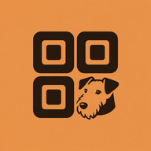

# QRessi



Сканер и редактор QR-кодов для Android с веб-версией. React, TypeScript, Gravity UI, Capacitor и AI. Без аккаунта и собственного сервера.

AI помогал при разработке кода и иконки.

## Возможности

- Создание QR с текстом, ссылкой, Wi-Fi, контактом, адресом почты, телефоном, координатами или ссылкой на приложение Google Play.
- Квадратные, мягкие и точечные модули; выбор цвета через HEX, RGB, HSL; градиенты и прозрачный фон.
- Картинка или короткий текст в центре и проверка читаемости перед экспортом.
- Экспорт PNG и SVG; на Android PNG можно сохранить прямо в галерею или поделиться им.
- Сканирование с камеры Android с приближением, фонариком и вибрацией, а также распознавание выбранного изображения.
- Локальная история, удаление свайпом с отменой, экспорт и импорт резервной копии JSON.
- На Android — геолокация, буфер обмена и выбор установленного приложения с иконками.

Android-сканер распознаёт QR, Aztec, Data Matrix, PDF417, Codabar, Code 39/93/128, EAN-8/13, ITF, UPC-A/E. Создание доступно для QR. Анимированные QR пока не реализованы.

Веб-версия умеет создавать QR, читать QR с изображения и хранить историю в текущем браузере. Нативные функции Android в ней недоступны. iOS-проект пока не добавлен.

## Запуск веб-версии

Нужны Node.js 22.12+ (для CI используется Node.js 24) и pnpm 11.25.0.

```sh
npm install --global pnpm@11.25.0
pnpm install --frozen-lockfile
pnpm dev
```

Production-сборка: `pnpm build`. Результат находится в `dist/`; проверить его можно через `pnpm preview`.

## Android

Нужны Android Studio, JDK 21, Android SDK Platform 36 и Build Tools 36.0.0. Минимальная версия устройства — Android 7.0 (API 24). Gradle Wrapper и конфигурация проекта уже включены: устанавливать или настраивать Gradle вручную не требуется.

1. Установите зависимости командой выше.
2. Выполните `pnpm android:sync`.
3. В Android Studio откройте папку `android/` и дождитесь синхронизации Gradle. Если IDE предложит использовать её стандартный Android SDK, согласитесь. Локальный `android/local.properties` не хранится в Git.
4. В Device Manager создайте/запустите эмулятор или подключите устройство с USB debugging. Выберите конфигурацию `app` и нажмите Run.

Для сборки из терминала с JDK 21 и `ANDROID_HOME`, указывающим на установленный SDK:

```sh
pnpm android:apk
```

APK: `android/app/build/outputs/apk/debug/app-debug.apk`. Android application ID: `app.qressi.mobile`.

GitHub Actions также собирает debug APK при push в `master`; файл доступен в артефактах workflow **Build Android APK** в течение 7 дней.

Debug-ключ создаётся Android-инструментами локально. Production-ключ, пароли подписи и сертификаты не входят в репозиторий. Для публикации в магазине настройте release-подпись локально в Android Studio.

## GitHub Pages

В Settings → Pages → Build and deployment выберите **GitHub Actions**. Workflow `.github/workflows/pages.yml` собирает веб-версию при push в `main`/`master` или ручном запуске; персональные токены не нужны. Адрес для этого репозитория: `https://dimared.github.io/qressi/` после успешной публикации.

Локальная проверка такой сборки:

```sh
pnpm build:pages
```

Префикс по умолчанию `/qressi/`; для другого пути задайте переменную `PAGES_BASE`. Папки `dist/` и `dist-native/` генерируются и не коммитятся.

## Данные и конфиденциальность

История и черновики остаются на устройстве. Картинки обрабатываются локально. История и JSON-копии не шифруются приложением: в них могут быть Wi-Fi-пароли, контакты и другие данные из QR. В браузере очистка данных сайта удалит историю.

Android-сканер использует Google ML Kit. По документации Google изображения и результаты распознавания не отправляются на их серверы, но SDK может передавать технические метрики и получать обновления. Подробности — [политика конфиденциальности](public/PRIVACY.md).

## Структура и разработка

| Каталог    | Содержимое                                                |
| ---------- | --------------------------------------------------------- |
| `src/`     | интерфейс, создание QR, история, браузерное распознавание |
| `android/` | Gradle-проект, Activity и нативные плагины                |
| `public/`  | иконки и сведения о конфиденциальности                    |

Камера и редактор на Android используют отдельные WebView: это обходит проблему отрисовки цветовых полей в некоторых эмуляторах. Экраны сохраняются при переключении. Не следует глобально переводить WebView камеры в software rendering.

Иконки уже включены в Git и не требуют генерации при обычной сборке. Исходное фото собаки в репозиторий не включено; иконка — сгенерированная стилизация эрдельтерьера. Название вдохновлено Рэсси из «Приключений Электроника»; проект не связан с правообладателями фильма.
